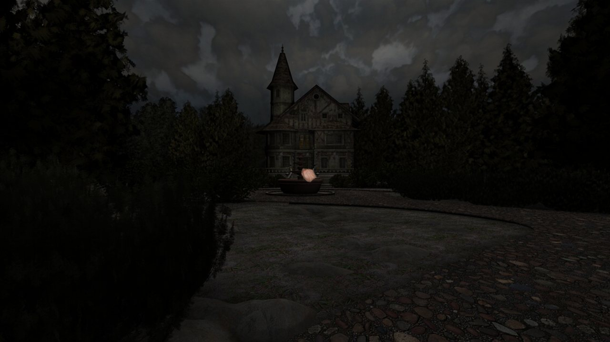
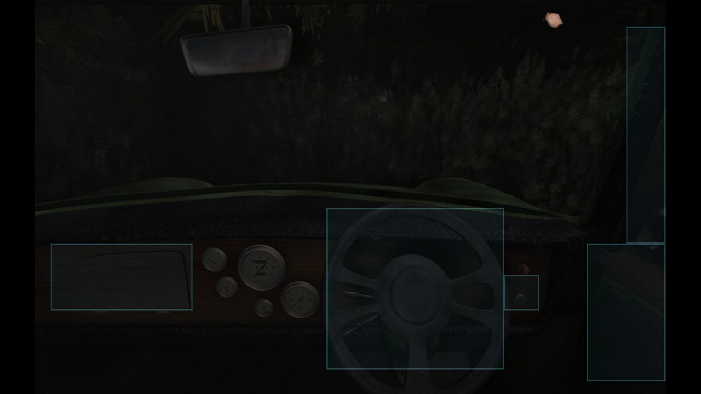
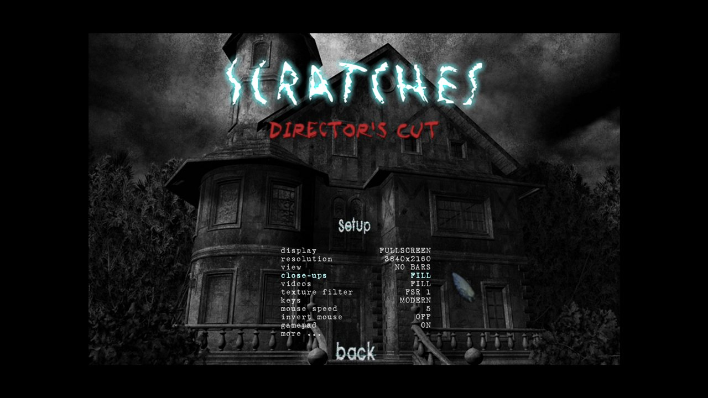

<div align="center">

# scream-rs

**A from-scratch Rust reimplementation of the SCream engine behind _Scratches: Director's Cut_.**

[](https://github.com/extremecodetv/scream-rs/actions/workflows/ci.yml)
[](https://github.com/extremecodetv/scream-rs/actions/workflows/release.yml)


Any resolution · widescreen · modern renderer · gamepad · FSR 1 · quality-of-life options —<br>
running the game's **original, unmodified scripts and data**.



</div>

---

## What is this?

[_Scratches_](https://store.steampowered.com/app/46460/) (Nucleosys, 2006) is a first-person
horror adventure built on Nucleosys' own engine, **SCream**: pre-rendered cube panoramas,
close-ups, cutscenes and a Lua-scripted world. The Director's Cut ships `scream.exe`, a 32-bit
Windows binary that hard-codes a 1024×768 layout and old fixed-function OpenGL.

**scream-rs replaces `scream.exe`.** It was rebuilt from a full decompilation of the original
binary, function by function, and it runs the game exactly as shipped:

- it executes the **original compiled Lua 5.1 bytecode** (`scream.sc`, `scratches.sc`) — a small
  transcoder adapts the 32-bit chunks to a 64-bit Lua VM;
- it reads the original `.res` archives, TGA/JPEG textures, Ogg Vorbis audio, Theora videos and
  `.srt` subtitles;
- it implements all **87 `sc*` script functions** with the original semantics: nested frame
  loops for blocking calls, cross-fades on every view switch, timers, the inventory, the
  journal, dialogue choices, ambience presets, weather and lighting effects, save games.

No game files are included or modified. You need your own copy of
_Scratches: Director's Cut_ (it includes the _The Last Visit_ episode, which works too).

## Highlights

| | Original `scream.exe` | scream-rs |
|---|---|---|
| Resolution | 1024×768 layout, stretched | any window size or monitor mode, DPI-aware |
| Aspect ratio | 4:3 | Hor+ widescreen, original 4:3, or full-window panoramas |
| Rendering | fixed-function OpenGL | wgpu (Vulkan / Direct3D 12 / Metal) |
| Upscaling | bilinear | bilinear or **AMD FSR 1** (EASU + RCAS) |
| Close-ups and videos | fixed size | original, fit, fill or stretch — hotspots follow |
| Input | mouse, odd keyboard layout | mouse, modern or original keys, **gamepad** |
| Comfort | — | hotspot highlight, click to skip, autosave, large subtitles, message history, separate volumes |
| Platforms | Windows (32-bit) | Windows, Linux, macOS (64-bit) |

Every addition is an option in the in-game menu and can be switched back to the original
behaviour. The full list is in **[docs/OPTIONS.md](docs/OPTIONS.md)**.

<table>
  <tr>
    <td></td>
    <td></td>
  </tr>
  <tr>
    <td align="center"><sub>Hold TAB (or X on a gamepad) to highlight hotspots</sub></td>
    <td align="center"><sub>Port options live in the original setup menu</sub></td>
  </tr>
</table>

## Getting started

### Download

Prebuilt binaries for Windows, Linux and macOS are attached to each
[release](https://github.com/extremecodetv/scream-rs/releases).

### Build from source

You need a stable [Rust toolchain](https://rustup.rs) and a C compiler (Lua is built from
source). On Linux you also need the ALSA and udev headers:

```sh
sudo apt install pkg-config libasound2-dev libudev-dev   # Debian/Ubuntu only
cargo build --release
```

### Run

Point the port at the folder of your installed game, the one that contains `scratches.sc` and
`scratches.res`:

```sh
scream-rs --game "C:\Program Files (x86)\Steam\steamapps\common\Scratches"
```

Without `--game`, scream-rs looks in the current folder, next to its executable, and in the
default Steam library paths. You can also simply copy `scream-rs` into the game folder — it
does not replace the original `scream.exe`.

Settings and save games are kept separate from the original game:

| OS | Folder |
|---|---|
| Windows | `%APPDATA%\scream-rs\` |
| Linux | `~/.config/scream-rs/` |
| macOS | `~/Library/Application Support/scream-rs/` |

## Controls

| Input | Action |
|---|---|
| Left click | walk, look, use, take |
| Right click | inventory / put an item back |
| Mouse at the screen edge | turn (or mouse look in *alternate control* mode) |
| Arrows / WASD | turn and tilt (layout depends on the *keys* option) |
| Esc | menu, skip a line or a video |
| TAB (hold) | highlight hotspots |
| H (hold) | message history |
| F1 / F2 | hints / surround music |
| F5 / F7 | quick save / quick load |
| F9 / F10 | camera speed / text speed |
| F11 / F12 | fullscreen / gamma |

Gamepads are supported out of the box; see the [mapping](docs/OPTIONS.md#gamepad-mapping).

## How it is built

| Layer | Implementation |
|---|---|
| Window and input | winit 0.30, pumped explicitly so that blocking script calls can run nested frame loops, like the original's `PeekMessage` loop |
| Gamepad | gilrs |
| Rendering | wgpu: textured quads with the original blend modes, a CPU-side transform pipeline, an offscreen frame for cross-fades, WGSL ports of FSR 1 EASU/RCAS |
| Scripting | mlua (Lua 5.1, vendored) plus a bytecode transcoder for the 32-bit `size_t` of the original chunks |
| Audio | cpal + lewton: an 18-channel mixer modelled on the original OpenAL layer (fades, panning, per-channel gain) |
| Video | theora-rs (a pure Rust libtheora port), decoded on a worker thread |
| Images | the engine's own TGA conventions, `image` for JPEG |
| Saves | JSON |

```
src/
├── main.rs       command line, game folder discovery
├── engine.rs     main loop, states, view switches, input, menus, sound, saves
├── script.rs     the 87 sc* functions exposed to Lua
├── bytecode.rs   Lua 5.1 chunk transcoder (32-bit → 64-bit size_t)
├── world.rs      rooms, nodes, close-ups, objects, items, scripts, choices, timers
├── render.rs     frame composition: sky dome, masks, cube faces, effects, 2D screens, text
├── gfx.rs        wgpu renderer, layout and scaling, FSR 1 shaders
├── camera.rs     panorama camera
├── ui.rs         subtitles, dialogue choices, journal
├── audio.rs      channel mixer
├── video.rs      Theora playback
├── save.rs       save games
├── config.rs     scream.cfg, scSet/scGet/scEnable
├── options.rs    port options and their menu pages
├── gamepad.rs    gamepad mapping
├── platform.rs   window, display modes, input events
├── res.rs        .res archives
├── imgload.rs    TGA/JPEG loading
└── sc.rs         engine constants
```

## Development

The engine can be driven from the command line, which makes visual regression checks easy:

```sh
# Jump straight into a location, hold TAB, take a screenshot at frame 330 and quit
scream-rs --skip-videos --windowed 1600x900 \
       --exec "scSwitch(SC_ROOM,'garden'); scSwitch(SC_NODE,'n1')" \
       --input "300:key:Tab" --shot garden.png 330
```

| Flag | Purpose |
|---|---|
| `--game <dir>` | game folder |
| `--console` | show a console window with the log (Windows release builds start without one) |
| `--windowed <W>x<H>`, `--pos <x> <y>` | window size and position |
| `--opt <KEY> <VALUE>` | port option for this run (see [OPTIONS](docs/OPTIONS.md)) |
| `--skip-videos` | do not play cutscenes |
| `--script <path>` | run another script (a `.sc` or `.lua` file, without extension) |
| `--exec "<lua>"` | run Lua when the main loop starts |
| `--input "<frame>:<kind>:<arg>;..."` | scripted input: `click`, `rclick`, `move`, `look`, `key`, `keyup` |
| `--snap <png> <frame>` / `--shot <png> <frame>` | screenshot at a frame / and quit |

Runs with test flags never overwrite the player's settings. Set `RUST_LOG=scream=debug` (with `--console`) for a
detailed log. The `examples/` folder holds small tools used during development (archive and
script probes, image diff and crop).

## Status

The game boots, plays and saves on the original scripts: menus, the intro, panoramas,
close-ups, the inventory, the journal, dialogue, videos and save/load all work, and _The Last
Visit_ starts from the same menu. Panoramas and close-ups were compared screenshot by
screenshot against the original engine. A complete playthrough has not been verified yet, so
expect the occasional divergence — bug reports are very welcome, ideally with a save file and
the log.

Windows is the primary platform. Linux and macOS builds are produced by CI but have had little
testing.

## Acknowledgements

- **Nucleosys** and Agustín Cordes for _Scratches_ and the SCream engine.
- **AMD FidelityFX Super Resolution 1** (MIT license) — the EASU and RCAS shaders in `gfx.rs`
  are WGSL ports of the reference implementation.
- The Rust crates this port stands on: wgpu, winit, mlua, cpal, lewton, theora-rs, gilrs, glam,
  image and serde.

## Legal

scream-rs is an unofficial fan project, not affiliated with or endorsed by Nucleosys. It
contains no game data; _Scratches_ and its assets are the property of their respective owners.
Buy the game to play it.
